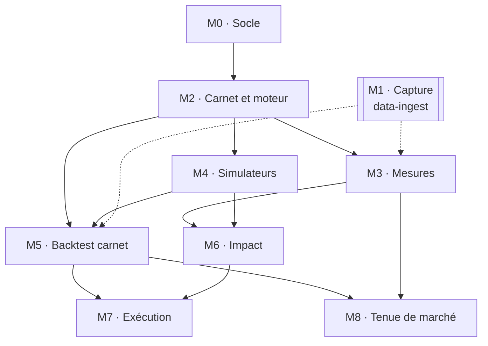

# Blueprint — quant-microstructure

Spécification du chantier. Les lots et leurs critères d'acceptation sont au
[§13 du compagnon](../docs/companion.md#13-les-lots) ; ce fichier en donne la
vue d'ensemble et le graphe de dépendances. Les arbitrages, avec leurs
alternatives écartées, sont dans [`decisions.md`](decisions.md).

Quand un lot devient assez gros pour mériter sa propre spécification, elle va
dans `wp/<lot>-<nom>.md` et le tableau ci-dessous y renvoie.

## 1. Pourquoi ce dépôt existe

Le mainteneur a étudié le pricing de dérivés et les xVA (`quant-modeling`),
puis le backtest (`quant-backtest`). Ces trois sujets supposent tous un prix
auquel on traite. Ce dépôt étudie ce que cette hypothèse cache : le carnet
d'ordres, le coût d'une transaction, la fourniture de liquidité.

Il est séparé des autres parce qu'il ne partage rien avec eux : ni les
données (événement par événement, pas quotidiennes), ni les types (des
entiers, pas des `double`), ni les outils mathématiques (processus ponctuels,
pas diffusions), ni le cycle de vie.

Deux buts, comme pour `quant-platform` : **comprendre** (le compagnon de
lecture, les modèles à vérité connue qu'on simule pour retrouver leur formule)
et **construire** (un carnet et un moteur dont la performance est mesurée).
Quand ils divergent, c'est le premier qui gagne : on code Roll, Kyle et
Glosten-Milgrom alors qu'aucun n'est utile en production, parce qu'ils sont la
base de tout le reste.

## 2. Les lots

| Lot | Titre | Dépôt | Résumé |
|---|---|---|---|
| M0 | Socle | ici | CMake, presets, vcpkg, GoogleTest, google-benchmark, clang-format, CI, squelette du wheel |
| M1 | Capture | `data-ingest` | Enregistrement continu du carnet et des transactions d'une bourse de cryptomonnaies ; contrôles de qualité |
| M2 | Carnet et moteur d'appariement | ici | Carnet L3, priorité prix-temps, reconstruction L2, premier benchmark |
| M3 | Mesures et faits stylisés | ici | Fourchettes, déséquilibre, variance réalisée, graphique de signature, signe des transactions, fonction de réponse |
| M4 | Simulateurs de flux | ici | Intelligence zéro, Hawkes, queue-reactive, modèles jouets |
| M5 | Backtest au niveau du carnet | ici | Latence, position dans la file, exécutions, frais ; sur rejeu et sur simulateur |
| M6 | Impact | ici | Fonction de réponse, propagateur, lambda de Kyle, loi en racine carrée en simulateur |
| M7 | Exécution | ici | Almgren-Chriss, TWAP, VWAP, POV, analyse des coûts |
| M8 | Tenue de marché | ici | Avellaneda-Stoikov, Guéant-Lehalle-Fernandez-Tapia, markouts |

## 3. Graphe de dépendances

À lire ainsi :

- **M2 est la fondation** : tout le reste lit ou produit le flux d'événements
  qu'il définit. C'est aussi le lot où le C++ compte le plus.
- **M1 ne bloque rien** (flèches en pointillé) : M3 et M5 se développent et se
  testent sur des flux simulés, puis tournent sur les données capturées quand
  elles existent. Mais un flux capturé ne remonte pas dans le passé :
  **démarrer M1 tôt**, pour que l'historique s'accumule pendant que le reste
  se construit.
- **M3 et M4 sont indépendants** entre eux et peuvent avancer en parallèle.
- **M7 et M8 sont les deux aboutissements** : celui qui prend la liquidité et
  celui qui la fournit. Ils sont indépendants l'un de l'autre.

## 4. Définition de « fait »

Un lot est fait quand :

1. ses critères d'acceptation du §13 du compagnon passent, sous forme de tests ;
2. chaque formule codée a été revérifiée dans l'article, et l'équation est
   citée dans le commentaire ;
3. `clang-format` et la CI sont verts, y compris le preset `asan` ;
4. s'il touche le carnet ou le moteur, le benchmark est relancé et son résultat
   mis à jour dans le dépôt ;
5. `CLAUDE.md` (état du dépôt, commandes) est à jour ;
6. son issue est fermée avec le commit.
